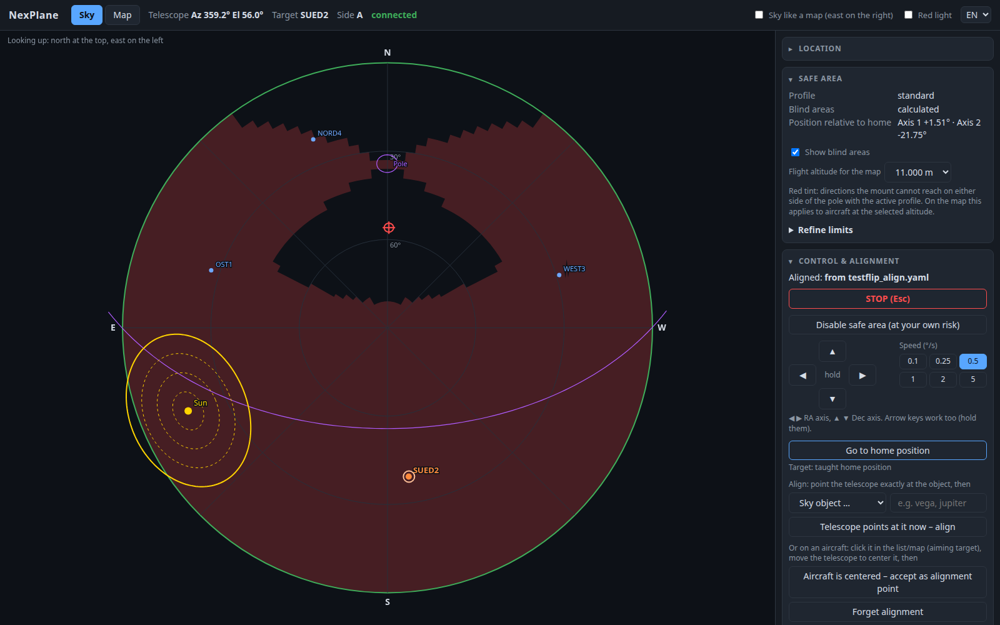
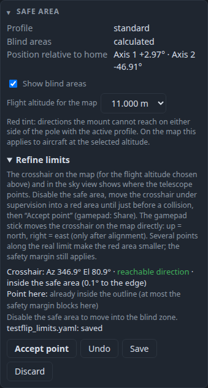
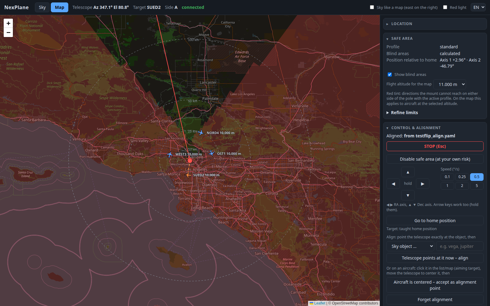
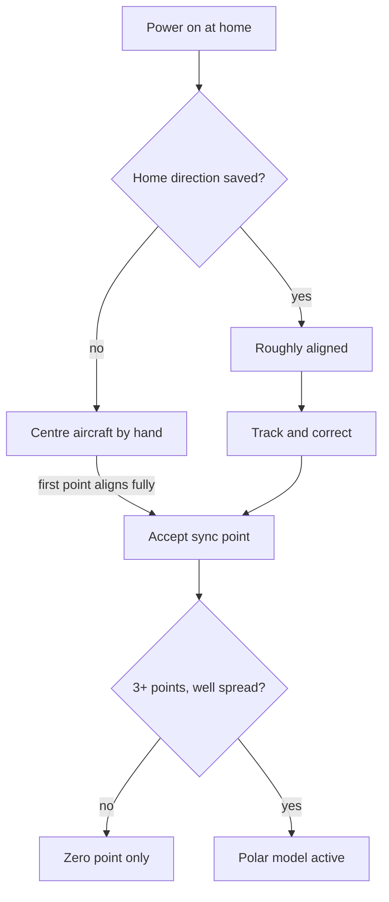
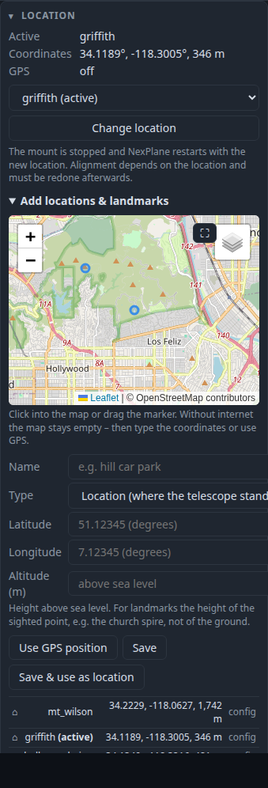

# NexPlane Extended – feature guide

NexPlane Extended adds the features below to [NexPlane](https://github.com/nforrester/NexPlane).
They grew out of tracking aircraft with a Sky-Watcher EQ5 in equatorial mode, operated from a
browser and a PS4 controller, which is also where they were tested. This document explains what
each feature does, how it works, how to try it and how well it has been tested.

- **Base:** upstream `master`, commit `f0fe174` ("Fix bug in arg validation").
- **Without new config keys NexPlane behaves as upstream**, except that `--web` and the gamepad
  become available.
- Most of the code was written with Claude (an AI assistant) and reviewed and field-tested by the
  fork owner.
- Features 1–27 have been proposed upstream as separate pull requests; see
  [Status of the upstream pull requests](#status-of-the-upstream-pull-requests).



## Contents

- [Test status](#test-status)
- [Feature overview](#feature-overview)
- [Mount safety (1–3, 23, 24, 27)](#mount-safety)
- [Equatorial mode (4, 5, 21)](#equatorial-mode)
- [Browser GUI (6–9)](#browser-gui)
- [Pointing and alignment (10–14, 25, 26)](#pointing-and-alignment)
- [Gamepad (15)](#gamepad)
- [Places, GPS and elevation (16–18)](#places-gps-and-elevation)
- [Tools and fixes (19, 20, 22)](#tools-and-fixes)
- [Configuration reference](#configuration-reference)
- [Files written by NexPlane](#files-written-by-nexplane)
- [Known limitations](#known-limitations)
- [Development tests](#development-tests)

## Test status

Most features were tested in the HOOTL simulator (`SkyWatcherSerialHootl`, about 90 ms per
command) with fake SBS-1 aircraft, a FIFO standing in for the gamepad and a fake `mmcli`. Part of
it has run on real hardware.

**Real hardware:** Sky-Watcher EQ5, motor controller firmware 3.47.49 (USB, 115200 baud,
9,011,200 steps per revolution) behind a Prolific PL2303 adapter; Dell laptop with a DW5821e LTE
modem; RTL-SDR with dump1090; PS4 controller over Bluetooth; Ubuntu with GNOME Terminal.

| Status | Meaning |
| --- | --- |
| Field | Used on the real mount under the sky |
| Bench | Ran on the real laptop or devices, not under the sky |
| Sim | Automated simulator or unit tests only |

The simulated mount is ideal, so pointing-model results there prove the maths, not the accuracy
under a real sky.

## Feature overview

"Needs" lists the features that must be present first.

| # | Feature | Main files | Needs | Status |
| --- | --- | --- | --- | --- |
| 1 | Axis soft limits (taught polygon) | `axis_limits.py`, `teach_limits.py`, `limits_plot.py` | – | Field |
| 2 | Exclusion zones and limit profiles | `axis_limits.py`, `teach_limits.py` | 1 | Sim |
| 3 | "Limits off" switch for alignment | `axis_limits.py`, `webgui.*` | 1, 6 | Sim, used once in the field |
| 4 | Meridian flip, both pier sides | `eq_flip.py`, `tracker.py`, `align.py` | 1 | Sim |
| 5 | Blind-area (reachability) map | `reach_map.py`, `webgui.*` | 1, 4, 6 | Sim |
| 6 | Browser GUI (`--web`) | `webgui.py`, `webgui.html`, `webgui_static/` | – | Field |
| 7 | Manual jog, go-home, align in the browser | `eq_flip.py`, `webgui.*` | 4, 6 | Field |
| 8 | Location presets in the browser | `nexplane.py`, `webgui.*` | 6 | Sim |
| 9 | German/English language switch | `webgui.html`, `webgui_static/` | 6 | Sim |
| 10 | Correction in the camera/axis frame | `eq_flip.py`, `nexplane.py` | 4 | Field |
| 11 | Sync points and per-setup pointing model | `pointing_model.py`, `eq_flip.py` | 10 | Sim |
| 12 | Alignment without a landmark | `nexplane.py`, `pad_control.py` | 11 | Sim |
| 13 | Focal-length weighting, point list | `pointing_model.py`, `webgui.*` | 11 | Sim |
| 14 | Forget alignment | `nexplane.py`, `webgui.*` | 11 | Sim |
| 15 | Gamepad (PS4) control | `gamepad.py`, `pad_control.py` | 10 | Bench |
| 16 | Places editor with map picker | `places.py`, `config.py`, `webgui.*` | 6, 8 | Bench |
| 17 | GPS from the WWAN modem | `gps.py`, `gps_check.py` | 6 | Bench / Sim |
| 18 | Ground elevation lookup | `elevation.py`, `webgui.*` | 16 | Sim |
| 19 | Start script | `start_nexplane.py` | – | Bench |
| 20 | Serial port auto-detection skips modems | `telescope_server.py`, `mount_check.py` | – | Bench |
| 21 | Fewer position queries per tracking cycle | `eq_flip.py`, `tracker.py` | 4 | Sim |
| 22 | Clear startup error, tracking and sync logs | `nexplane.py`, `tracking_log.py` | – | Sim |
| 23 | Refine limits from the browser | `axis_limits.py`, `nexplane.py`, `webgui.*` | 1, 3, 5 | Sim, bench |
| 24 | Gamepad moves the map crosshair north/east | `pad_control.py`, `nexplane.py`, `webgui.*` | 15, 23 | Sim |
| 25 | Refuse alignment targets near the celestial pole | `eq_flip.py`, `nexplane.py` | 4, 7 | Sim |
| 26 | Rough test alignment at home (test mode) | `nexplane.py`, `webgui.*` | 1, 7 | Sim, bench |
| 27 | Axis position relative to home in the GUI | `nexplane.py`, `webgui.*` | 1, 6 | Sim |

`webgui.*` means `webgui.py` and `webgui.html`.

## Mount safety

A long tube on an equatorial mount can hit the tripod or pier. NexPlane drives the mount fast and
in directions the user may not expect, so every motor command now passes through a guard that keeps
the mount inside a taught area of **raw axis positions**.

### 1 Axis soft limits

- **How it works:** `AxisLimitGuard` wraps `SkyWatcher._slew_axis` and `_inquire_position`. The
  allowed area is a polygon in (axis 1, axis 2) degrees relative to the power-on counts, with a
  safety margin (default 3°). Before each command the guard predicts the joint motion
  (`lookahead_seconds`, default 1 s) and scales both axes down so that the margin is never
  crossed. A ray-exit test handles non-convex outlines.
- **Independent of alignment:** the polygon is in raw axis space relative to the taught home
  position, so it does not depend on where the mount is pointed or how it is aligned. It is only
  valid if the mount was switched on at the home position.
- **Extra protections:** emergency stop if an axis moves against the commanded direction by more
  than 0.5°; optional check that the mount starts at the taught home position. Starting outside the
  area only warns and allows moves back inside.
- **Teaching:** `teach_limits.py` is a curses UI. Jog to the edge, press `m` per corner, `s` to
  save. `--check` loads the file and enables the guard for a dry run; `g` writes an SVG preview;
  the terminal shows an ASCII map of the outline.
- **Config:** `axis_limits.file` (or profiles, see 2), `margin_degrees`, `lookahead_seconds`,
  `require_home_at_start`, `home_tolerance_degrees`, `wrong_way_trip_degrees`. Without an
  `axis_limits` section NexPlane behaves as before.
- **Try it:** `./teach_limits.py --hootl --telescope-protocol skywatcher-mount-head-usb`, teach a
  square, then run it again with `--check` and jog into the edge.

### 2 Exclusion zones and profiles

- **Exclusion zones** are holes inside the outline (`n` starts one, `m` adds corners, `e` ends
  it). The guard treats the distance to a hole edge like the outline. In the simulator a diagonal
  move stopped 2.08° before a zone with a 2° margin.
- **Profiles** cover different setups on the same mount, for example a long tube and a small camera:
  `axis_limits.profiles: {tube: limits_tube.yaml, camera: limits_camera.yaml}` plus `profile:` for
  the default. Switching in the browser stops the mount; all profiles must share the same home
  position (checked).
- `teach_limits.py --profile NAME --edit` loads an existing file to add zones.

### 3 "Limits off" switch

- A browser button disables the guard at the user's own risk, for example to align on a landmark
  outside the area. It needs a confirmation, shows a red banner and blocks aircraft tracking. The
  wrong-direction stop stays active.
- When the guard is re-enabled outside the area, only moves back inside are allowed, at most
  0.5°/s.

### 23 Refine limits from the browser



- **Idea:** many red (unreachable) areas on the map come from a conservatively taught outline.
  With the safe area disabled, the user moves the telescope under supervision into a red area and
  accepts the current axis position as a new boundary vertex.
- **Display:** while "Refine limits" is open, a crosshair shows where the line of sight reaches the
  selected flight altitude on the ground map, and a larger crosshair marks the telescope in the sky
  view. Both are green inside the safe area and red outside. A status line says whether the
  direction is in a red cell and what a point here would do.
- **Geometry:** `insert_vertex` puts the point on the nearest edge that keeps the polygon simple
  and only changes the area in the intended direction. Outside the outline it may only add the
  triangle (edge, point); inside an exclusion zone it may only cut that triangle away. An edge is
  skipped if the area would change the wrong way or another vertex lies inside that triangle.
  Without this check a point in a concave pocket could remove area elsewhere: a random test found
  15 such cases in about 3,300 with the first version, and 0 now. Every change is validated (no
  self-crossing, home inside, zones valid). Points closer than 0.2° to the edge are refused.
- **What to expect:** the safety margin still applies, so a spike narrower than twice the margin
  frees nothing. Several points along the real limit move the boundary out; a single point on a
  densely taught outline gains almost nothing.
- **Workflow:** points take effect at once and the red areas are recomputed. Undo, Save (writes the
  active profile's file and keeps the previous version as `.bak`) and Discard (reloads the file).
  The gamepad Share button accepts a point.

### 24 Gamepad moves the map crosshair

While "Refine limits" is open and the mount is aligned, the left stick moves the crosshair on the
ground map: up = north, right = east, at the flight altitude selected in the browser.
`pad_control.map_to_altaz_rate` turns the map direction into az/el rates with the same
Earth-curvature projection as the map, `altaz_rate_to_radec_rate` converts to RA/Dec rates, and
`radec_rate_to_raw_rate` inverts the numerical Jacobian of `EqPointing.raw_to_radec`, so both pier
sides and the pointing model are covered. Without alignment, or if the line of sight does not reach
the altitude on the map, the stick behaves as usual. Unit test: direction error below 0.02° at
five sky positions on both sides.

### 27 Axis position relative to home

The safe-area card shows "Position relative to home: axis 1 …°, axis 2 …°". If the tube visibly
stands at home but this is not about 0°/0°, the motor counters do not match (the mount was powered
on elsewhere, or moved by hand with the clutches open) and both the map and new limit vertices
would be shifted.

## Equatorial mode

Upstream EQ mode works on one pier side only. These changes handle both sides and let the limits
decide which one to use.

### 4 Meridian flip

- **Model:** `d = dec_raw + dec_cal`. For d ≤ 90° the scope is on side A (dec = d,
  ra = ra_raw + ra_cal). Beyond the pole it is on side B (dec = 180° − d, ra + 180°).
  `EqPointing.raw_to_radec` returns the side.
- **Candidates:** for each target both raw positions are computed; RA is also tried at ±360°, and
  Dec is snapped to the nearest equivalent because `align.yaml` stores 0–360°. Each candidate gets
  its clearance from the guard.
- **Choosing a side:** a new target gets the side where it stays reachable longest (look-ahead at
  15, 30 and 60 s with the aircraft's extrapolation). While tracking, the mount flips only when the
  current side becomes unreachable and the other side has at least 1° of margin, then holds for
  10 s to avoid flapping.
- **Alignment:** `eq_flip.calibrate` uses the taught home Dec to tell whether the alignment object
  was approached on side A or B (`align.py` uses the same). `tracker.go_raw` drives unwrapped raw
  targets with a limit on the total rate.
- **Test tool:** "Test side change" in the browser holds the current direction and drives to it on
  the other side.
- **Config:** `meridian_flip` (default true), `max_slew_degrees_per_second` (default 5). Without
  limits the automatic flip is off.

### 5 Blind-area map

- `reach_map.py` evaluates a 3° × 3° az/el grid (30 × 120 cells) in a background thread in about
  0.3 s: reachable on side A, side B, both or neither. A fixed az/el maps to a fixed axis position,
  so the grid is only recomputed after alignment, a profile change or a model update.
- The browser tints unreachable sky red. The ground map shows the same region for a chosen flight
  altitude (3,000–13,000 m) with Earth curvature, out to 450 km.
- The simplified az/el → HA/Dec conversion differs from astropy by at most 0.15°; the guard itself
  always uses the exact values.



### 21 Fewer position queries per tracking cycle

The EQ loop read the mount position three times per cycle (`scope()`, `command()`, `go_raw()`),
each costing two serial commands. `EqPointing` now reuses a reading younger than 0.15 s and passes
it on to `go_raw`. In the simulator the tracking cycle dropped from about 0.7 s to 0.4 s; the
timing on real USB hardware is not measured yet.

## Browser GUI

`--web` replaces the OpenGL window with a local web page. OpenGL stays the default and becomes
optional: a missing GLUT no longer breaks `--web`.

### 6 Web server and views

- **Server:** `webgui.WebGui` implements the interface that the main loop uses for `gui.py`
  (planes, tracked target, offsets, gains, telescope position). It runs a `ThreadingHTTPServer` on
  127.0.0.1 only (port `web_port`, default 8765). Every API call needs a random per-start token in
  the `X-NexPlane-Token` header, and the Host header is checked, so other web pages cannot drive
  the mount.
- **Views:** a sky view on a canvas (alt/az, optionally mirrored "like a map") and a ground map
  with Leaflet 1.9.4 served from `webgui_static/` (OpenStreetMap tiles need internet). Aircraft
  list, tracked-target card with Flightradar24, FlightAware and AirNav Radar links (ICAO → IATA
  flight number table), PID gain card, messages, red-light mode, collapsible cards.
- **Options:** `web_gui: true` in the config makes `--web` the default; `--no-browser` skips
  opening a browser.

### 7 Manual control and alignment in the browser

- Hold-to-jog buttons and arrow keys for both axes (0.1–5°/s) with a 0.5 s dead-man timeout, a
  go-home button and a STOP button (Esc).
- Align by choosing a landmark (another configured location) or a sky object and pressing
  "Telescope points at it now"; the result is written to `align.yaml`. Tracking is blocked until
  the mount is aligned.

### 8 Location presets

The active location can be changed from a list. NexPlane stops the mount and restarts itself with
`os.execv` and the new `--location`, dropping `--alignment` and `--landmark`.

### 9 Language switch

A selector in the header switches the GUI between English and German; the choice is kept in the
browser (default: the browser's language). Every text in the GUI follows the selected language,
including messages from NexPlane. Terminal output is always English.

- **English is the source language** everywhere: in `webgui.html` and in the Python code.
- **Messages from Python** are `messages.Msg` objects: an English template with named parameters,
  e.g. `Msg('Point {n} accepted ({name}).', n=3, name='DLH123')`. `str(msg)` gives the English
  text for the terminal; the browser receives template and parameters separately, so it can
  translate the template and fill in the values. No text matching with regular expressions is
  needed.
- **German texts** are in `webgui_static/i18n_de.js`, one entry per English template.
  `devtests/unit/test_i18n.py` collects every template from the Python code (`Msg('...')`), the
  page script (`T('...')`) and the static HTML and checks that each has a German entry with the
  same placeholders.

## Pointing and alignment

The first field test showed aircraft several degrees off with a 150–600 mm lens, mainly from a
poor daytime polar alignment and a single landmark due north. These features turn manual
corrections into a pointing model for the current setup.

### 10 Correction in the camera/axis frame

- The upstream offset is in az/el and resets for each target. In EQ mode the correction is now an
  offset of the raw axes (`corr_ra`, `corr_dec`), applied in `EqPointing.candidates` and removed
  in `raw_to_radec`. It equals a shift of the calibration, so it is valid on both pier sides and is
  kept for all targets.
- Input is in image directions: `image_to_axes` divides the RA part by cos d (clamped at 0.15) and
  flips its sign beyond the pole, because the camera is fixed to the Dec axis. A unit test confirms
  equal image motion at d = 10°…170° on both sides.
- W/A/S/D and the arrow buttons step it by 0.1° (Shift: 0.5°); Q sets it to 0.

### 11 Sync points and pointing model

- **Sync point:** while an aircraft is tracked and centred, "Accept" (gamepad ✕) stores the time,
  the raw axes and the true RA/Dec from the extrapolated ADS-B position, and refits the model. The
  landmark used for alignment is point 1.
- **Model (`pointing_model.py`):** parameters ra_cal, dec_cal, a polar-axis tilt (ex, ey) as a
  rotation fixed in the hour-angle frame, and a cone error c, fitted only with points on both sides
  (4 or more points). The mechanical pointing is rotated into the true frame:

  ```math
  \vec p_{true} = R_x(e_x)\,R_y(e_y)\,\big(\cos c\;\vec v(H_m, d_m) + \sin c\;\vec u(H_m)\big),\quad H_m = \mathrm{LST} - (ra_{raw} + ra_{cal}),\; d_m = dec_{raw} + dec_{cal}
  ```

- **Fit:** weighted Gauss–Newton with numerical derivatives (numpy only). The tilt is accepted only
  with 3 or more points, a 1-sigma uncertainty under 0.5° and a tilt under 8°. Otherwise only the
  zero point is fitted to the latest point, and a hint asks for a point in another direction.
- **Output:** the browser shows the polar-axis error as "0.8° too low, 1.1° too far east" (usable
  for adjusting the mount), the residual of each point, and flags points over 0.5°.
- **Simulator results:** with a 1.2°/−0.8° tilt the error over the sky dropped from 2.4° max to
  below 0.01° after the landmark plus 2 aircraft points; with 0.15° noise per point, from 1.39° to
  0.17° mean.

### 12 Alignment without a landmark

- Before alignment a selected aircraft becomes an "aiming target": NexPlane does not move, the user
  centres it by hand (stick or jog buttons) and accepts it (gamepad ✕ or the button in the
  browser). That point fully calibrates the mount via `eq_flip.calibrate`.
- After every alignment the RA axis orientation at the taught home position is saved
  (`home_direction.yaml`, an hour angle). On the next start NexPlane is roughly aligned from home,
  provided the mount was set up roughly facing north and switched on at home.



### 13 Focal-length weighting and point list

Each point records the focal length chosen in the browser (or cycled with the gamepad Options
button). Its weight assumes centring to 3% of the frame width (APS-C, 23.5 mm, `sensor_width_mm`)
plus 0.05° ADS-B error. In the simulator a coarse 150 mm point 1° off plus four 600 mm points gave
0.04° mean error instead of 0.21° unweighted. Any point can be deleted from the list.

### 14 Forget alignment

Discards points, model and correction and returns to "not aligned"; optionally also deletes
`home_direction.yaml` (for indoor tests where home did not face north).

### 25 Refuse alignment targets near the celestial pole

An alignment on a target within 10° of a celestial pole (Polaris is 0.7° away) cannot determine
the rotation of the RA axis: every RA position points at nearly the same spot, and the pier side is
ambiguous. On the bench such an alignment rotated the whole sky mapping, so half the map showed as
unreachable. `eq_flip.pole_problem` now refuses these targets for landmark and sky alignment and
for the first aircraft point, with an explanation. Later sync points are not affected.

### 26 Rough test alignment at home

A "test mode" for indoor tests without a landmark or a view of the sky. It assumes the mount was
powered on at the taught home position: counterweight down, tube at the pole, roughly facing north.
The counterweight shaft is the Dec axis, so it lies in the meridian plane, and a Dec move from home
swings the tube east or west: the RA axis is at hour angle ±90°. NexPlane sets +90°; a
"Turn by 180°" button switches to −90° after the user checks which side the display shows. Nothing
is written to disk. A real alignment, "End test mode" or "Forget alignment" ends it. This is good
enough for refining limits indoors, because the limit vertices do not depend on alignment.

## Gamepad

A gamepad lets the user correct and choose targets while standing at the camera; the browser does
not need focus.

### 15 Gamepad control

- **Reader (`gamepad.py`):** reads `/dev/input/event*` directly with `struct` and `ioctl` (no
  `evdev` package). It finds the first device with `BTN_SOUTH`, `ABS_X` and `ABS_Y`, reads the axis
  ranges with `EVIOCGABS`, applies a dead zone and reconnects after Bluetooth drops (axes return to
  0, so nothing keeps moving). Rumble uses `EVIOCSFF` with an `FF_RUMBLE` effect and turns itself
  off silently if unsupported.
- **Test mode:** `./gamepad.py --test` lists input devices and prints buttons and axes live. Access
  may need `sudo usermod -aG input $USER`.
- **Mapping (`pad_control.py`):**

| Control | While tracking | Not tracking |
| --- | --- | --- |
| Left stick | Correction, up to 0.4°/s | Jog, 1°/s; while refining limits: crosshair north/east on the map (24) |
| Right stick | Fine correction, 15% | Slow jog |
| R2 (analog) | Up to 6× faster | Up to 5°/s |
| D-pad | 0.02° correction steps | – |
| ✕ / □ / ○ | Accept sync point / delete last point / correction to 0 | Same |
| Share | – | While refining limits: accept the current axis position as a vertex |
| △ | Stop everything | Stop |
| R1 / L1 | Next nearest reachable aircraft / previous | Before alignment: slowest aircraft above 15° as aiming target |
| Options | Cycle focal length 150/300/600 mm | Same |

- Stick values use an x·|x| curve for fine control. `invert_x`, `invert_y` and `swap_xy` adapt to
  the camera orientation; all rates are in the `gamepad:` config section.
- **Status:** steering and correction confirmed with a PS4 controller over Bluetooth; rumble and the
  full button set were tested only with a simulated device.

## Places, GPS and elevation

A wrong observer position shifts every aircraft (up to about 3° for 1 km of error at 20 km range),
so new sites can be set up from the browser.

### 16 Places editor with map picker



- New locations and landmarks are saved in `places.yaml` next to `config.yaml`;
  `config.read_config` merges its `locations` after `config.yaml`. `config.yaml` is never
  rewritten, and its entries cannot be overwritten from the browser.
- Entries carry `type: location` or `type: landmark`. Landmarks appear only as
  alignment targets, not in the location list.
- A Leaflet picker in the Location card: click or drag a marker, OpenStreetMap or Esri satellite
  layer, full-screen mode. "Save & use as location" saves and restarts NexPlane with it. Name, range
  and duplicate checks are in `places.validate`.

### 17 GPS from the WWAN modem

- `gps.GpsReader` polls ModemManager (`mmcli --location-enable-gps-nmea`, then `--location-get`
  every 5 s) and parses GGA sentences. The browser shows the fix and warns in the header when the
  active location is more than 300 m away; "Use GPS position" fills the editor.
- `gps_check.py` is a stand-alone diagnostic (rfkill, modem ports, ModemManager capabilities,
  passive NMEA, optional XTRA assistance data). On a DW5821e it got a fix after several minutes at a
  window.

### 18 Ground elevation lookup

- Clicking in the picker fills in the altitude from `GET /api/elevation`, which `elevation.py`
  answers on the server: OpenTopoData EU-DEM 25 m first (Europe), then Open-Meteo Copernicus
  GLO-90 (global). At most 1 request per second, results are cached.
- An altitude that was typed, taken from GPS or edited is not overwritten. For landmarks the GUI
  reminds the user to add the building height.

## Tools and fixes

### 19 Start script

`start_nexplane.py` opens GNOME Terminal windows for dump1090, `telescope_server.py` and NexPlane
(`--web`), and optionally `satellites.py` after asking (refreshing TLEs older than 2 days). When
NexPlane ends, the helper windows close too; programs that were already running are left alone.
It waits for dump1090 on TCP 30003 and for `telescope_server` on its UDP port. `--hootl` gives a
dry run. The programs run with the same Python as the script; dump1090 comes from the config key
`dump1090` (path of the executable, default: `dump1090` on the `PATH`) or `--dump1090`, and the
mount protocol is the usual `telescope_protocol` setting.

### 20 Serial port auto-detection

Upstream `serial_port: auto` takes the first `/dev/ttyUSB*`. On a Dell laptop the built-in LTE
modem owned `ttyUSB0`–`3` (driver `option`) and the mount was `ttyUSB4`, so the mount "did not
answer". `find_mount_port` now skips modem drivers (`option`, `qcserial`, `sierra`, …) and prefers
`pl2303`, `ch341`, `cp210x` and `ftdi_sio`. `mount_check.py` lists ports with their drivers and
holders and sends 20 `:e1` queries.

### 22 Startup error and logs

- If the mount does not answer at start, NexPlane prints a checklist (power, cable, port, SynScan
  app) instead of the `UnboundLocalError` that the `finally` block used to raise.
- `logs/tracking_<time>.csv` logs about 5 rows per second while tracking (aircraft az/el and
  rates, telescope az/el, side, raw axes, correction, calibration). `logs/sync_points.csv`
  logs every sync point with the model state. Both are meant for measuring ADS-B latency and real
  pointing errors (`track_log: false` disables them).

## Configuration reference

All new keys are optional.

| Key in `config.yaml` | Default | Feature |
| --- | --- | --- |
| `web_gui`, `web_port` | false, 8765 | 6 |
| `axis_limits.file` or `axis_limits.profiles` + `profile` | none (limits off) | 1, 2 |
| `axis_limits.margin_degrees` | 3.0 | 1 |
| `axis_limits.lookahead_seconds` | 1.0 | 1 |
| `axis_limits.require_home_at_start`, `home_tolerance_degrees` | true, 1.0 | 1 |
| `axis_limits.wrong_way_trip_degrees` | 0.5 | 1 |
| `meridian_flip` | true | 4 |
| `max_slew_degrees_per_second` | 5.0 | 4, 7 |
| `gamepad.enabled`, `name`, `device` | true, first gamepad | 15 |
| `gamepad.invert_x`, `invert_y`, `swap_xy`, `deadzone` | false, false, false, 0.12 | 15 |
| `gamepad.correction_deg_per_s`, `fast_factor`, `fine_factor`, `step_degrees` | 0.4, 6, 0.15, 0.02 | 15 |
| `gamepad.jog_deg_per_s`, `jog_fast_deg_per_s`, `min_elevation_degrees`, `rumble` | 1.0, 5.0, 8, true | 15 |
| `focal_lengths_mm`, `focal_length_mm`, `sensor_width_mm` | [150, 300, 600], 150, 23.5 | 13 |
| `gps` | true | 17 |
| `track_log` | true | 22 |
| `dump1090` | `dump1090` on the `PATH` | 19 |

Example for an EQ5 with limits, the browser GUI and a gamepad:

```yaml
mount_mode: eq
telescope_protocol: skywatcher-mount-head-usb
web_gui: true
axis_limits:
    profiles:
        tube: limits_tube.yaml
        camera: limits_camera.yaml
    profile: tube
    margin_degrees: 3.0
gamepad:
    enabled: true
```

## Files written by NexPlane

All next to `config.yaml`:

| File | Written by | Feature |
| --- | --- | --- |
| `limits*.yaml`, `*_preview.svg` | `teach_limits.py`, refining in the browser | 1, 2, 23 |
| `align.yaml` | `align.py`, alignment in the browser | upstream, 7 |
| `home_direction.yaml` | every alignment with a taught home | 12 |
| `places.yaml` | places editor | 16 |
| `logs/*.csv` | tracking and sync point logs | 22 |

Config keys and file names are English. Setups that used the earlier German names
(`orte.yaml`, `home_richtung.yaml`, `brennweiten_mm`, …) can be converted with
`devtests/migrate_names.py`.

## Known limitations

- **Not measured yet:** ADS-B latency and real pointing residuals (the CSV logs exist for this), and
  the tracking cycle time on real USB hardware.
- **Alignment lifetime:** `ra_raw` includes the sidereal time since NexPlane started (upstream
  design), so a saved `align.yaml` and the model are only valid for one program run. The
  home-direction file avoids this by storing an hour angle, but assumes the mount was powered on
  at the taught home position.
- **Platform:** gamepad (evdev ioctl layout of 64-bit Linux), GPS (ModemManager) and the start
  script (GNOME Terminal, hard-coded paths) are Linux-only.
- **Simulator with real limits:** a limits file taught on the real mount has a different number of
  steps per revolution than the simulator (9,011,200 vs. 9,216,000), so `axis_limits` must be
  commented out for `--hootl` runs.
- **Third-party services:** OpenStreetMap and Esri tiles, OpenTopoData and Open-Meteo are public
  services with usage terms and rate limits. Offline, only typed coordinates and GPS work.

## Development tests

[`devtests/`](devtests/README.md) holds the unit and simulator test scripts used during
development: polygon geometry, refining, pointing model, gamepad over a FIFO, and Playwright tests
of the browser GUI against the HOOTL simulator. They are not part of the upstream pull requests.

## Status of the upstream pull requests

Features 1–27 were split into small pull requests against `nforrester/NexPlane`, with dependent
features stacked on top of each other: #10–#38 form one chain (each PR depends on the one before;
its own change is the last commit of the branch), #39 is based on `master` and #40 on #16. Each
branch was checked with `run_test.py 0` (mypy) before it was submitted.

| PR | Branch | Title |
| --- | --- | --- |
| [#10](https://github.com/nforrester/NexPlane/pull/10) | `pr/00-startup-error` | Clear message when the mount does not answer at start |
| [#11](https://github.com/nforrester/NexPlane/pull/11) | `pr/01-axis-limits` | Axis soft limits for Sky-Watcher mounts (taught polygon) |
| [#12](https://github.com/nforrester/NexPlane/pull/12) | `pr/02-limits-exclusion-zones` | Axis limits: exclusion zones |
| [#13](https://github.com/nforrester/NexPlane/pull/13) | `pr/03-limits-profiles` | Axis limits: profiles for different setups |
| [#14](https://github.com/nforrester/NexPlane/pull/14) | `pr/04-meridian-flip` | Equatorial mode: both pier sides and automatic meridian flip |
| [#15](https://github.com/nforrester/NexPlane/pull/15) | `pr/05-fewer-position-queries` | EQ tracking: read the mount position once per cycle |
| [#16](https://github.com/nforrester/NexPlane/pull/16) | `pr/06-web-gui` | Browser GUI (--web) |
| [#17](https://github.com/nforrester/NexPlane/pull/17) | `pr/07-web-gui-languages` | Browser GUI: English/German, messages as templates |
| [#18](https://github.com/nforrester/NexPlane/pull/18) | `pr/08-web-gui-meridian-flip` | Browser GUI: pier side display and side-change test |
| [#19](https://github.com/nforrester/NexPlane/pull/19) | `pr/09-web-gui-manual-control` | Browser GUI: manual control, go-home and alignment |
| [#20](https://github.com/nforrester/NexPlane/pull/20) | `pr/10-web-gui-limit-profiles` | Browser GUI: safe area card with profile switch |
| [#21](https://github.com/nforrester/NexPlane/pull/21) | `pr/11-limits-off-switch` | Browser GUI: switch the axis limits off at your own risk |
| [#22](https://github.com/nforrester/NexPlane/pull/22) | `pr/12-axis-position-display` | Browser GUI: axis position relative to home |
| [#23](https://github.com/nforrester/NexPlane/pull/23) | `pr/13-blind-area-map` | Browser GUI: map of directions the mount cannot reach |
| [#24](https://github.com/nforrester/NexPlane/pull/24) | `pr/14-location-presets` | Browser GUI: switch between configured locations |
| [#25](https://github.com/nforrester/NexPlane/pull/25) | `pr/15-axis-frame-correction` | EQ mode: correction in the camera image |
| [#26](https://github.com/nforrester/NexPlane/pull/26) | `pr/16-pointing-model` | EQ mode: sync points and a pointing model |
| [#27](https://github.com/nforrester/NexPlane/pull/27) | `pr/17-align-without-landmark` | EQ mode: alignment without a landmark |
| [#28](https://github.com/nforrester/NexPlane/pull/28) | `pr/18-focal-length-weighting` | Pointing model: weight sync points by focal length |
| [#29](https://github.com/nforrester/NexPlane/pull/29) | `pr/19-forget-alignment` | Browser GUI: forget alignment |
| [#30](https://github.com/nforrester/NexPlane/pull/30) | `pr/20-refuse-pole-targets` | Refuse alignment targets near the celestial pole |
| [#31](https://github.com/nforrester/NexPlane/pull/31) | `pr/21-gamepad` | Gamepad (PS4 controller) control |
| [#32](https://github.com/nforrester/NexPlane/pull/32) | `pr/22-tracking-logs` | CSV logs of tracking and sync points |
| [#33](https://github.com/nforrester/NexPlane/pull/33) | `pr/23-places-editor` | Browser GUI: places editor with map picker |
| [#34](https://github.com/nforrester/NexPlane/pull/34) | `pr/24-gps` | GPS position from a WWAN modem |
| [#35](https://github.com/nforrester/NexPlane/pull/35) | `pr/25-ground-elevation` | Places editor: ground elevation lookup |
| [#36](https://github.com/nforrester/NexPlane/pull/36) | `pr/26-refine-limits` | Refine the axis limits from the browser |
| [#37](https://github.com/nforrester/NexPlane/pull/37) | `pr/27-gamepad-map-crosshair` | Refine limits: gamepad moves the map crosshair |
| [#38](https://github.com/nforrester/NexPlane/pull/38) | `pr/28-test-alignment-mode` | Rough test alignment at home |
| [#39](https://github.com/nforrester/NexPlane/pull/39) | `pr/mount-port-detection` | Skip cellular modems when picking the serial port |
| [#40](https://github.com/nforrester/NexPlane/pull/40) | `pr/start-script` | start_nexplane.py: start dump1090, telescope_server and NexPlane |

Features added after that (see the overview) live in this fork only for now. They are built the
same way, as one branch per feature stacked on the chain, so they can be proposed later.
